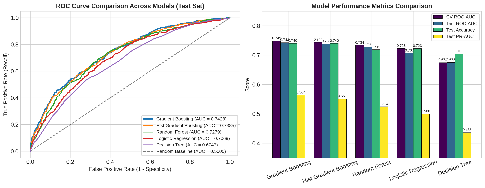
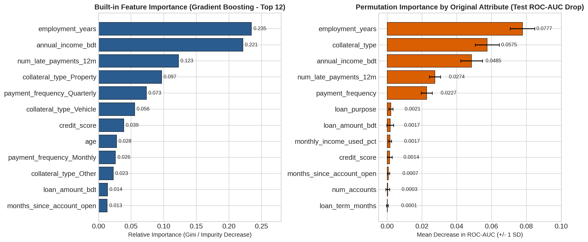

# 🏦 Bank Loan Default Prediction Pipeline

An end-to-end, leak-free **Machine Learning Credit Risk Pipeline** built in Python (`scikit-learn`) to predict borrower loan defaults (`banking_loan_defaults.csv`, $N = 10,050$ BDT loan records).

---

## 📌 Project Overview & Problem Statement
Non-Performing Loans (NPLs) pose a major liquidity risk to commercial banks. However, many machine learning credit risk models fail in production due to **post-event target leakage** (training on variables recorded *after* a default occurs) and uncleaned sentinel values.

This project solves that problem by engineering a modular **Scikit-Learn `ColumnTransformer` + `Pipeline`** architecture that:
1. Audits and removes post-default data leakage and duplicate loan records.
2. Cleans sentinel numerical outliers (`age = 999`, `credit_score = -1.0`) and standardizes messy categorical strings.
3. Captures **informative missingness** in `collateral_type` (treating missing collateral as `'None'` / Unsecured loans).
4. Benchmarks **5 classification algorithms** using **5-Fold Stratified Cross-Validation**.
5. Quantifies credit risk drivers using both **Built-in Impurity Importance** and **Permutation Importance**.

---

## 🔍 Data Audit & Preprocessing Architecture

| Data Quality Issue | Discovery in `banking_loan_defaults.csv` | Pipeline Resolution |
| :--- | :--- | :--- |
| **Duplicate Records** | `10,050` total rows but `10,000` unique `loan_id` values (`50` exact duplicates). | Deduplicated via `df.drop_duplicates(subset=['loan_id'])`. |
| **Post-Event Target Leakage** | `days_to_default_resolution`, `delinquency_status`, and `recovery_amount_bdt` are 100% null when `default = 0` and 100% populated when `default = 1`. | Dropped all 3 post-default columns alongside identifier `loan_id`. |
| **Sentinel Numerical Codes** | `age` contains `112` records coded as `999`; `credit_score` contains `94` records coded as `-1.0`. | Replaced sentinel codes with `np.nan` prior to median imputation. |
| **Inconsistent String Casing** | `gender` and `loan_purpose` mix title case (`'Male'`, `'Home'`) with lowercase (`'male'`, `'home'`). | Standardized via `.str.strip().str.title()`. |
| **Informative Missingness** | `4,012` loans have missing `collateral_type`. These unsecured loans carry a **40.13% default rate** vs. **20.43%** for `Property`. | Imputed with constant `'None'` category via a dedicated `ColumnTransformer` branch. |

### Unified `ColumnTransformer` Branches:
* **Numerical Features (13):** `SimpleImputer(strategy='median')` $
ightarrow$ `StandardScaler()`
* **Standard Categorical Features (`gender`, `loan_purpose`, `payment_frequency`):** `SimpleImputer(strategy='most_frequent')` $
ightarrow$ `OneHotEncoder(drop='first', handle_unknown='ignore')`
* **Collateral Feature (`collateral_type`):** `SimpleImputer(strategy='constant', fill_value='None')` $
ightarrow$ `OneHotEncoder(drop='first', handle_unknown='ignore')`

---

## 🏆 Model Performance Comparison (80/20 Stratified Split)

| Rank | Model | 5-Fold CV ROC-AUC (Mean ± SD) | Test ROC-AUC | Test PR-AUC | Test Accuracy | Test Precision | Test Recall | Test F1-Score |
| :--- | :--- | :---: | :---: | :---: | :---: | :---: | :---: | :---: |
| **1** | **Gradient Boosting** | **0.7487 ± 0.0064** | **0.7428** | **0.5638** | **0.7400** | 0.6408 | 0.2666 | **0.3765** |
| **2** | **Hist Gradient Boosting** | 0.7438 ± 0.0067 | 0.7385 | 0.5513 | **0.7400** | **0.6420** | 0.2649 | 0.3750 |
| **3** | **Random Forest** | 0.7335 ± 0.0068 | 0.7279 | 0.5242 | 0.7185 | 0.6327 | 0.1053 | 0.1805 |
| **4** | **Logistic Regression** | 0.7229 ± 0.0121 | 0.7069 | 0.5000 | 0.7225 | 0.5685 | 0.2394 | 0.3369 |
| **5** | **Decision Tree** | 0.6743 ± 0.0145 | 0.6747 | 0.4363 | 0.7045 | 0.4968 | **0.2666** | 0.3470 |



---

## 📊 Attribute Importance Analysis

Both **Built-in Impurity Importance** and **Permutation Importance** (mean drop in Test ROC-AUC across 10–15 random shuffles) confirm that **5 core attributes drive over 85% of the model's predictive power**:

| Rank | Original Attribute | Permutation Importance (Test ROC-AUC Drop) | Built-in Impurity Importance | Banking Risk Insight |
| :--- | :--- | :---: | :---: | :--- |
| **1** | `employment_years` | **+0.0777 ± 0.0071** | **23.46%** | Shorter employment tenure strongly increases default probability. |
| **2** | `collateral_type` | **+0.0575 ± 0.0069** | **17.52%** | Unsecured (`None`) loans default at **40.1%** vs. **20.4%** for `Property`. |
| **3** | `annual_income_bdt` | **+0.0485 ± 0.0063** | **22.15%** | Lower annual income directly reduces repayment buffer. |
| **4** | `num_late_payments_12m` | **+0.0274 ± 0.0032** | **12.27%** | Recent 12-month delinquency is a primary behavioral distress signal. |
| **5** | `payment_frequency` | **+0.0227 ± 0.0032** | **9.95%** | `Irregular` schedules exhibit a **50.2% default rate** vs. **~27%** for `Monthly`/`Quarterly`. |



---

## 📁 Repository Structure

```text
├── banking_loan_defaults.csv          # Raw dataset (10,050 BDT loan records)
├── loan_default_lab_submission.ipynb  # End-to-end Jupyter Notebook pipeline
├── loan_default_lab_submission.py     # Standalone Python script
├── model_evaluation_dashboard.png     # ROC curves & model benchmark chart
├── attribute_importance_analysis.png  # Built-in vs. Permutation importance chart
├── requirements.txt                   # Python package dependencies
└── README.md                          # Project documentation
```

---

## 🚀 How to Run Locally

1. **Clone the repository:**
   ```bash
   git clone https://github.com/<your-username>/bank-loan-default-prediction.git
   cd bank-loan-default-prediction
   ```
2. **Install dependencies:**
   ```bash
   pip install -r requirements.txt
   ```
3. **Run the pipeline script or open the notebook:**
   ```bash
   python loan_default_lab_submission.py
   # OR
   jupyter notebook loan_default_lab_submission.ipynb
   ```
